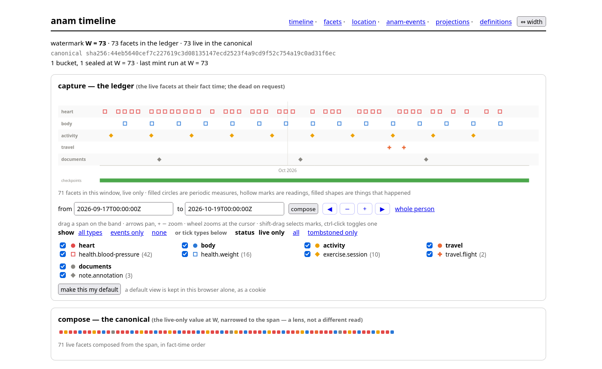

# Anam

> *anam*: Irish for *soul*.

A personal, longitudinal record of one person's life, kept as immutable facts. Health readings,
workouts, medicines, lab results, trips, documents and notes land on one timeline, each with where
it came from and when it was true. The current state is derived from the facts, every cache of it
is rebuilt by replay, and nothing is ever overwritten.

This is a personal project, published so others can read it and borrow from it. The sources, units
and time zone in the examples are the author's.



*The inspector, served by the daemon, over a month of made-up facts. Each mark is a facet at its
fact time; the green strip is the checkpoints.*

## Ideas

- **The whole-person timeline is the default read.** A trip, an illness or a training block is an
  optional lens over it, never a requirement.
- **Facts accrete.** A correction is a new version beside the old one. `--as-of` shows what Anam
  knew at any earlier moment.
- **Two clocks.** Fact time is when something was true. Anam time is when Anam learned it.
- **One way in.** Every fact arrives through an admission gate that checks it against a
  Definition, so a bad row never enters the record.
- **Proof of what was shown.** A projection prunes the timeline for a reader, and a receipt proves
  exactly what it served.
- **Anam reads no source itself.** Importers do that, and the facts can be resent from them. What
  Anam authors, and what a person says straight into it, come back from the backup.

## Four words the commands print

The **ledger** is the record: an append-only file of facets. **W** is the watermark, the position
of the newest event in it, and every answer says the W it stood on. The **fold** is the current
value worked out from the ledger, and the **canonical** is that value's hash: it moves when a fact
lands and is the same after a rebuild from source. Checkpoints cache the fold by month, so a read
need not replay everything.

## Quick start

You need Go (see `go.mod` for the version). Nothing here needs another machine or a token;
everything runs on loopback against two SQLite files.

```sh
make build

# person_id has no default on purpose: it is pinned into the ledger at init, so a
# defaulted one would name a person nobody chose for the life of the file.
export ANAM_PERSON_ID=me

# The ledger and the operational store are two SQLite files. Both default to
# ~/.local/share/anam/ (ledger.db and tracking.db); override with
# ANAM_LEDGER_PATH and ANAM_DB_PATH.
./anam init

# Run the daemon. On loopback it needs no token. Leave it running and use another terminal.
./anam daemon
curl http://127.0.0.1:8787/healthz                 # ready
ANAM_SERVER=http://127.0.0.1:8787 ./anam status   # the ledger id, W, and each importer's last batch
```

Open `http://127.0.0.1:8787/` for the inspector. With `ANAM_SERVER` set, every command below asks
the daemon; `init` and `daemon` refuse to run, because a configured server is treated as the owner
of the files. Unset it for those two commands.

**Read.** The whole-person timeline is the default, and everything else is a lens over it.

```sh
./anam timeline                                    # the canonical, whole
./anam timeline --from 2025-05-01 --to 2026-07-01  # narrowed by fact time
./anam changes --since 2026-07-10                  # what Anam learned since, by Anam time
```

**Publish and prove.** A projection prunes the canonical, and a receipt proves what was served.

```sh
./anam projection list                             # the templates: a reader selects one, the operator registers one
./anam timeline --projection bp --publish          # publish: a served value and a receipt, content-addressed
./anam receipt list
./anam receipt show <hash>          # what was served, from the stored receipt alone
./anam receipt verify <hash>        # re-derive it from the ledger, and re-hash the file
```

**Check a projection before publishing it**, and ask why a facet is in or out.

```sh
./anam timeline --projection bp                                # the served view, with its receipt hash
./anam timeline --projection bp --explain                      # every facet's verdict, and the reason
./anam timeline --projection bp --as-of 2026-07-10T20:00:00Z   # what it stood on when Anam knew less
```

**Mint.** A checkpoint caches the fold, one value per monthly bucket, to bound replay.

```sh
./anam checkpoint --dry-run         # which buckets would mint, and to what hash
./anam checkpoint                   # mint every bucket whose value moved
./anam checkpoint list              # every checkpoint ever minted
```

## How it fits together


*The gate and the ledger are the error kernel. Green is rebuilt by replaying the ledger, and
blue is Anam's own record, kept in the backup. The source is
[`anam-overview.excalidraw`](docs/assets/anam-overview.excalidraw), editable in Excalidraw.*

The same, as text:

```text
importers (envelopes, one token per source) → admission gate → append-only ledger (SQLite)
                                                                        │ replay
                                                                        ↓
                                        checkpoints (the fold, cached) ⇢ the fold
                                                                        ↓
                                              projections, the CLI, the API → receipts
```

The **ledger** is the record. It is a SQLite file whose triggers refuse any update or delete. A
second SQLite file holds what Anam itself authors: its derived tables are rebuilt by replaying the
ledger, and what the operator registered comes back from the backup. Facts reach the ledger only
through the gate, which checks each one is compliant with its Definition, authenticated, and
associated with the person.

What must not break is small: the ledger and the gate's checks. A commit is idempotent, so an
importer that crashed mid-batch runs again and nothing doubles. The second file is caught up by
replay, with no transaction across the two, so a crash leaves it behind and never wrong. Every call
carries a deadline, and a client may send a shorter one in `Anam-Timeout`. With the daemon down,
nothing is lost: the facts wait at their sources for the next run. A wrong fact is retracted, which
drops it from the current value and never from the ledger.

## Facet definitions

Every fact is a **facet** of a named type, and each type has a versioned **Definition**: a JSON
Schema, which field names the facet, and which field says when it was true. Definitions are
immutable once published, so a change is a new version. Anam bundles the 39 below, and importers
register more. A running daemon lists what it holds at `GET /v1/definitions` and in the
inspector's definitions page; the bundled files are in
[`internal/def/manifests/`](internal/def/manifests/), and the gate checks this table against them.
Adding a type is a Definition file, not code.

### Bundled with Anam

Every type is named `domain.concept[.specialisation…]`, and the first word is one of nine: `health`, `activity`, `place`,
`record` and `mind` today, with `social`, `money`, `media` and `work` held for later. A new kind of fact joins
one of them. A head is added only by a logged decision, as `mind` was. `family` groups types within a domain, and `kind` says whether a type
records a measure, a reading or an event.

| Type | Version | family | kind | What it records | Identity | Fact time |
|---|---|---|---|---|---|---|
| `health.heart-rate.day` | 1 | vitals | measure | One day's resting, minimum and maximum heart rate as one fact (replaces `health.heart-rate-day`'s three a day) | `id` | interval start |
| `health.heart-rate-alert` | 5 | vitals | event | One abnormal high heart rate alert from a watch | `source`, `kind`, `fact_time` | `fact_time` |
| `health.blood-pressure` | 7 | vitals | reading | One blood pressure reading, as an Open mHealth body | `date_excel`, `reading` | `date_excel` |
| `health.weight` | 5 | body | reading | One body weight | `id` | `date` |
| `health.body-composition` | 4 | body | measure | A period's body metrics (fat, muscle and the rest) | `group`, `period_type`, `period_start` | `period_start` |
| `health.sleep-episode` | 2 | sleep | measure | One sleep episode, as an IEEE 1752 sleep-episode body | `id` | interval start |
| `health.lab-panel` | 2 | labs | event | One pathology request, the header of a draw's report | `id` | `collected` |
| `health.lab-result` | 2 | labs | reading | One analyte's result from one draw | `id` | `collected` |
| `health.condition` | 1 | conditions | event | A condition named in a document | `id` | `date` |
| `health.illness.started` | 1 | conditions | event | The day an illness began (was `health.illness-started` v1, before the names took a third segment) | `id` | `date` |
| `health.illness.ended` | 1 | conditions | event | The day an illness ended (was `health.illness-ended` v1, before the names took a third segment) | `id` | `date` |
| `health.medication.started` | 1 | meds | event | A medicine course starting (was `health.medication-started` v1, before the names took a third segment) | `id` | `date` |
| `health.medication.dose-changed` | 1 | meds | event | A change of dose within a course (was `health.medication-dose-changed` v1, before the names took a third segment) | `id` | `date` |
| `health.medication.stopped` | 1 | meds | event | A course ending (was `health.medication-stopped` v1, before the names took a third segment) | `id` | `date` |
| `health.medication.dose` | 2 | meds | event | One dose of a medicine taken at a moment, outside any course (was `health.medication-dose` up to v2, before the names took a third segment) | `id` | `taken_at` |
| `health.medication.dose-missed` | 1 | meds | event | A dose the person says they missed (was `health.medication-missed-dose` v1, before the names took a third segment) | `id` | `date` |
| `health.medication.compliance` | 1 | meds | measure | The person's own estimate of how well they kept to a course (was `health.medication-compliance` v1, before the names took a third segment) | `id` | `date` |
| `health.encounter` | 1 | clinical | event | One appointment with a clinic or practitioner | `id` | `date` |
| `health.donation` | 1 | clinical | event | One visit to give blood | `id` | `date` |
| `health.vision-prescription` | 1 | clinical | reading | One lens prescription as an optometrist issued it, each eye as printed | `id` | `date` |
| `activity.exercise-session.garmin` | 1 | exercise | event | One session a Garmin watch recorded, as an IEEE 1752 physical activity (was `activity.exercise-session` up to v2, before each vendor had its own leaf) | `id` | session start |
| `activity.exercise-session.concept2` | 2 | exercise | event | One workout the Concept2 Logbook holds, as an IEEE 1752 physical activity (likewise) | `id` | session start |
| `activity.exercise-session.technogym` | 2 | exercise | event | One indoor session on a Technogym machine, as an IEEE 1752 physical activity (likewise) | `id` | session start |
| `activity.exercise-session.strong` | 2 | exercise | event | One Strong app workout, as an IEEE 1752 physical activity (likewise) | `id` | session start |
| `activity.gym-visit` | 1 | exercise | event | One gym visit | `id` | `date` |
| `activity.steps` | 2 | movement | measure | One day's steps, as an Open mHealth step-count body | `id` | interval start |
| `place.trip.departed` | 1 | trips | event | Leaving home on a trip (was `place.departed` v1, before the names took a third segment) | `id` | `date` |
| `place.trip.flight` | 1 | trips | event | One flight leg (was `place.flight` v1, before the names took a third segment) | `id` | `date` |
| `place.trip.arrived` | 1 | trips | event | Arriving at one place during a trip (was `place.arrived` v1, before the names took a third segment) | `id` | `date` |
| `place.trip.returned` | 1 | trips | event | Getting home from a trip (was `place.returned` v1, before the names took a third segment) | `id` | `date` |
| `mind.attention` | 1 | attention | reading | What is absorbing the person at a moment, with a topic and an intensity from 1 to 5, as the person says it | `id` | `at` |
| `mind.attention.started` | 1 | attention | event | The moment the person says a topic began to hold their attention; opens an episode of that topic | `id` | `at` |
| `mind.attention.ended` | 1 | attention | event | The moment the person says a topic stopped holding their attention; closes the episode | `id` | `at` |
| `record.edge` | 2 | notes | event | An edge joining facets, with or without words; a note in the person's own words is one (was `note.annotation` (v1 to v3), then `record.note` (v1, v2)) | `id` | `at` |
| `record.document` | 2 | documents |  | A pointer to one file in the documents library; the bytes never enter the ledger | `path` | `date` |
| `health.heart-rate-day` | 2 | vitals | measure | One figure for a day's heart rate, as an Open mHealth heart-rate body (replaced by `health.heart-rate.day`; the garmin importer's snapshot leaves it absent, the operator retracts it, and it is kept for reads as-of before) | `id`, `statistic` | interval start |
| `health.heart-rate` | 3 |  |  | A period's heart rate metrics (retired; tombstoned, kept for reads as-of before it) | `group`, `period_type`, `period_start` | `period_start` |
| `health.sleep` | 3 |  |  | A period's sleep metrics (retired; tombstoned, kept for reads as-of before it) | `group`, `period_type`, `period_start` | `period_start` |
| `health.metric-group` | 3 |  |  | A period's metrics for the health groups with no type of their own (retired; tombstoned, kept for reads as-of before it) | `group`, `period_type`, `period_start` | `period_start` |

### Registered by importers

These come with [`anam-importers`](https://github.com/mattjoyce/anam-importers), which publishes
them to the daemon on first use. Their versions are that repository's to state; the daemon's
`GET /v1/definitions` is the current answer.

| Type | What it records | Importer |
|---|---|---|
| `health.measurement.withings` | One Withings measurement (was `health.measurement`, before each vendor had its own leaf) | withings |
| `activity.day.garmin` | One day of a Garmin watch's daily summary (was `activity.day`, before each vendor had its own leaf) | garmin |
| `health.cpap-session.dreamstation` | One therapy session from a DreamStation card (was `health.cpap-session`, before each vendor had its own leaf) | dreamstation |
| `place.track` | One UTC hour of a phone's positions | owntracks |
| `place.stay` | One place a phone stayed, named from OpenStreetMap | stays |

## Getting facts in

Every source reaches Anam through an importer, in the sibling
[`anam-importers`](https://github.com/mattjoyce/anam-importers) repository. An importer reads one
source (Garmin, Withings, a blood pressure export, a DreamStation card, OwnTracks, Concept2),
shapes its rows to a Definition, and posts them to the daemon under its own token. Two formats
are Anam's own:

- **`records`**: hand-written YAML records for labs, medicines, travel and notes.
- **`documents`**: a folder of files with sidecars, each a `record.document`. The importer posts the
  bytes and Anam keeps them in its library.

The importers are plugins for the [ductile](https://github.com/mattjoyce/ductile) gateway, a small
scheduler and event router, but that is only how the author runs them. Each is a script that runs
by hand, and that repository's README says how. Anything that can post an envelope can feed Anam;
the contract is in [`docs/IMPORTERS.md`](docs/IMPORTERS.md).

## Letting an AI read it

An AI reaches the record through the daemon's API, and there are three ways to do that.

- **MCP.** [`anam-mcp`](https://github.com/mattjoyce/anam-mcp) is an adapter for any MCP client. It
  offers a few tools (describe the record, describe a type, read the timeline, verify a receipt)
  that cite their evidence, and two that write: the person's own words as a note, and a fact they
  ask to have recorded as a facet of any type, under their own source.
- **The CLI.** The `anam` command talks to the daemon when `ANAM_SERVER` is set, so a local model
  with a shell tool can run `anam timeline` and `anam changes` and read the output.
- **`curl`.** The API is plain HTTP and JSON, documented in [`docs/API.md`](docs/API.md). A skill for
  Claude Code, [`.claude/skills/anam-service`](.claude/skills/anam-service/SKILL.md), teaches the
  routes and the checks.

```sh
export ANAM_SERVER=http://127.0.0.1:8787 ANAM_TOKEN_FILE=~/.config/anam/token ANAM_ZONE=Australia/Sydney

anam timeline --from 2026-09-17 --to 2026-10-17
anam changes --since 2026-10-01

curl -H "Authorization: Bearer $(cat $ANAM_TOKEN_FILE)" \
  "$ANAM_SERVER/v1/timeline?zone=$ANAM_ZONE&type=health.blood-pressure"
```

A token exists only when the daemon was given a `token_file`, which it must have to listen beyond
loopback; the quick start above needs none. Routes are opened by role, not narrowed by it: every
role reads the whole record, an importer's token writes only as its own source and sees only its
own source's snapshots, and the operator's runs the daemon. The daemon holds only the hashes of the
tokens and reads them at start, so a leaked importer token means wrong facts under one source,
retractable, and revoking it is removing its hash and restarting.

## Docs

To understand it:

- [`docs/PRFAQ.md`](docs/PRFAQ.md): what Anam is and why. Start here.
- [`docs/compelling-reason-for-Anam.md`](docs/compelling-reason-for-Anam.md): the case in a page.
- [`docs/ARCHITECTURE.md`](docs/ARCHITECTURE.md): the model, contracts and mechanics.
- [`docs/explainer/explainer.html`](docs/explainer/explainer.html): a checked, one-concept-per-file
  tour of the code, rendered as a page.
- [`docs/HISTORY.md`](docs/HISTORY.md): where Anam came from. Optional reading.

To look something up:

- [`docs/API.md`](docs/API.md): the HTTP API.
- [`docs/GLOSSARY.md`](docs/GLOSSARY.md): the shared language.
- [`CHANGELOG.md`](CHANGELOG.md): what changed for an operator, an importer or a reader of the API,
  by the day it merged.
- [`AGENTS.md`](AGENTS.md): engineering standards and the design lens the code is reviewed through.

To do something:

- [`docs/IMPORTERS.md`](docs/IMPORTERS.md): how sources outside Anam feed it, and the contract each
  importer follows.
- [`docs/INBOX.md`](docs/INBOX.md): from a dropped document to facts in the ledger.

Records of a slice, kept as written:

- [`docs/MVP.md`](docs/MVP.md): the first slice, its scope and success criteria.
- [`docs/SELF-LOG.md`](docs/SELF-LOG.md): the self-log, documents as references, and the snapshot read.
- [`docs/pipeline.html`](docs/pipeline.html): the health pipeline that fed Anam before the importers,
  retired.

Every path above exists at the last merge; `scripts/check.sh` fails on a dead one.

## Status

As of October 2026, Anam holds the author's record and is read and written every day. The daemon
runs in a container on a home server and owns the two SQLite files; importers feed it through the
day from a watch, a scale, a blood pressure monitor, a CPAP machine, a phone, a rowing machine, the
hand-written records and a folder of documents; an assistant reads it over MCP and saves notes and
facts into it. A job on the same server asks the daemon for a backup every night, onto another
disk, and a rebuild from the importers has been drilled. There is no release: master is what runs,
and `anam version` names the build.

Not built yet: a remote MCP for clients away from the home network, and a model's own reading of
the person's words as drafts to endorse. Nothing is ever deleted: a mistake is a new version beside
the old one, and a retraction drops a fact from the current value and never from the ledger. When a
Definition changes shape, the affected facts are resent by their importer rather than migrated in
place. The kanban board, outside this repository, is where the work is tracked; this file is not
its status page.

## Licence

Apache-2.0, see [`LICENSE`](LICENSE). Third-party material, the IEEE 1752 schemas bundled for
conformance tests, is listed in [`NOTICE`](NOTICE).
